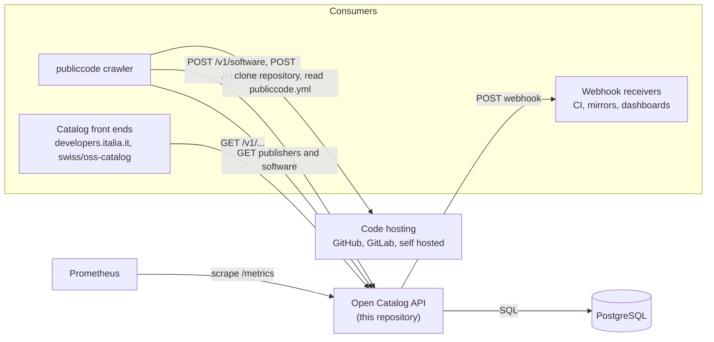
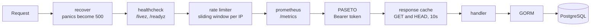
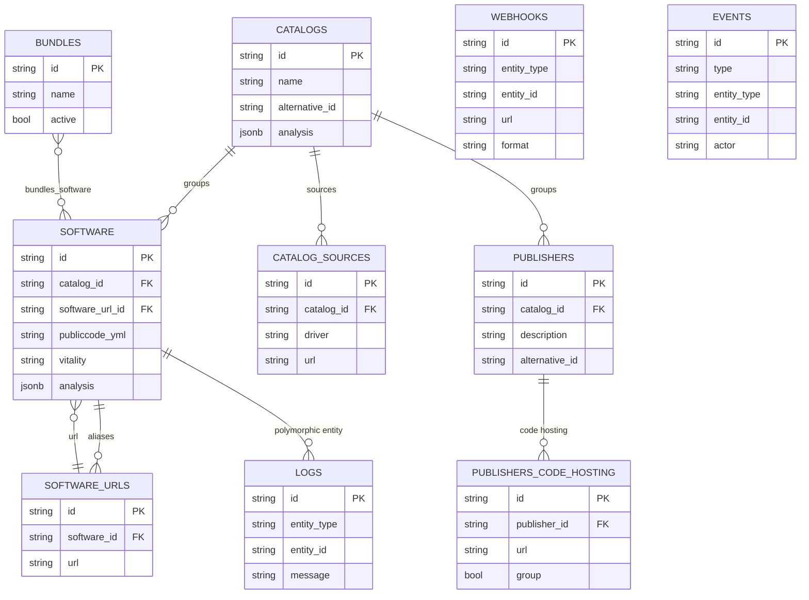
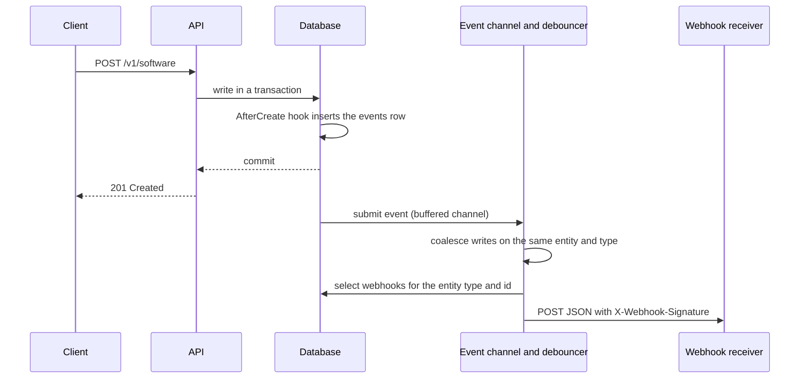

# Architecture

This document is an overview of the components the Open Catalog API is made of,
of the path a request follows through it, and of the data and events it keeps.
The HTTP contract itself lives in
[`open-catalog-api.oas.yaml`](../open-catalog-api.oas.yaml) and the environment
variables are listed in the [README](../README.md#configuration).

## Where the API sits

A catalog is a database of **publishers** (public administrations and other
organisations), of the **software** they publish, and of the **catalogs** that
group them. This repository is the API in front of that database: it is the
only component reading and writing it, and everything else talks to it over
HTTP.



The crawler is not part of this repository. It reads the code hosting URLs of
every publisher from the API, clones the repositories, parses
`publiccode.yml`, and writes what it finds back as software and log entries.
This API never fetches a repository itself: it stores what the crawler sends.

## Request path

Middleware is registered in `main.go` and runs in this order for every request:



- **Health checks** answer before any other middleware. Readiness runs
  `SELECT 1` against the database, so an instance whose connection pool is gone
  stops receiving traffic.
- **Rate limiting** counts requests per client IP in a sliding window of one
  minute (`MAX_REQUESTS`). The client IP comes from `X-Forwarded-For` only when
  the request arrives from an address listed in `TRUSTED_PROXIES`; otherwise
  the header is ignored and the peer of the connection is counted. It is off in
  the test environment and when `MAX_REQUESTS` is unset.
- **Authentication** uses [PASETO](https://paseto.io/) v2 local tokens sent as
  `Authorization: Bearer <token>`. Reads are public, except the webhook
  configuration and the audit trail; every write requires a valid token. When
  `PASETO_KEY` is unset the API generates a random key at startup and logs that
  it runs in read-only mode, because no token can be validated against it.
- **Response caching** keeps `GET` and `HEAD` answers for ten seconds, keyed on
  path plus query string. Status and authenticated resources are never cached.
- **Handlers** decode JSON strictly, rejecting unknown fields, and answer
  errors as `application/problem+json`. Collection endpoints are paginated and
  support a `search` query where the resource opts in. `PATCH` accepts both
  JSON Merge Patch (`application/merge-patch+json`) and JSON Patch
  (`application/json-patch+json`), and refuses to change immutable fields.

## Data model



Three tables are **polymorphic**: `logs`, `webhooks` and `events` point at any
entity with a pair of `entity_type` and `entity_id` columns instead of a
foreign key, so one schema serves catalogs, publishers, software and bundles.
`logs` also carries a generated, stored column `entity` holding
`/entity_type/entity_id`, used by the API to filter logs by subject.

An empty `entity_id` in `webhooks` means "every event of this type": a webhook
row with `entity_type = "software"` and no `entity_id` receives the events of
all software, while one carrying an `entity_id` receives only the events of
that row.

Logs are soft deleted, events are not: the retention job deletes rows older
than `EVENT_RETENTION_DAYS` at startup and once a day.

## Writes, events and webhooks

Every write that changes a catalog entity emits an event inside the same
transaction, and that event both feeds the audit trail and triggers the
matching webhooks:



- The **event row** is written by GORM hooks on create, update and delete of
  catalogs, publishers, software, bundles and webhooks. It records the entity,
  the kind of change, the actor, which is the `sub` of the token that
  authenticated the write, and the timestamp. It is exposed by
  `GET /v1/events`.
- The **channel** drives live delivery only. It is buffered, so a slow webhook
  receiver never blocks a write; if the buffer were full the event is logged and
  dropped, and the row stays in the database either way.
- The **debouncer** waits `WEBHOOK_DEBOUNCE_MS` of quiet per entity and event
  type before dispatching, capped by `WEBHOOK_DEBOUNCE_MAX_MS`, so a crawler
  writing the same software many times in a row produces one delivery. It is
  per replica and drains on shutdown.
- **Dispatch** selects the webhooks whose `entity_type` matches and whose
  `entity_id` is empty or equal to the event's, builds the payload for the
  configured `format`, and posts it in a goroutine.

The payload carries the event type and the subject, the path of the entity:

```json
{"event": "created", "subject": "/software/4b1f8e2c-..."}
```

The `default` format signs the body with HMAC-SHA256 using the webhook secret
and sends the digest hex encoded in `X-Webhook-Signature`. The `github` format
targets the `repository_dispatch` endpoint of a GitHub repository, so a catalog
event can start an Actions workflow: the secret is used as the bearer token and
the payload is wrapped in `client_payload`. The `standard-webhooks` format
follows the Standard Webhooks specification.

Deliveries run with a ten second timeout and a five second dial timeout, and
the dispatcher refuses to reach addresses outside the publicly routable space,
so a webhook cannot be pointed at the loopback interface or at a cloud metadata
service. Failed deliveries are logged and not retried: consumers are expected
to reconcile through `GET /v1/events`.

## Running and testing

`docker compose up` brings up the API and PostgreSQL and serves the catalog at
`http://localhost:3000/v1/`. Tests run against SQLite by default, with
`DATABASE_DSN` pointing at PostgreSQL to run them against it; CI runs both.
See [CONTRIBUTING.md](../CONTRIBUTING.md) for the toolchain and the checks
required before a pull request.

The image is built from the `Dockerfile` at the root, the Helm chart lives in
[`charts/open-catalog-api`](../charts/open-catalog-api), and releases are cut
with GoReleaser. The chart exposes the same knobs as the environment:
`/livez` and `/readyz` are the probe paths, and `/metrics` is scraped for
latency and status code of every route.

## Where to look next

- [`open-catalog-api.oas.yaml`](../open-catalog-api.oas.yaml): the HTTP
  contract, rendered at
  <https://publiccodeyml.github.io/open-catalog-api/>.
- [README](../README.md#configuration): every environment variable, with its
  default.
- [CHANGELOG.md](../CHANGELOG.md): what changed and when.
